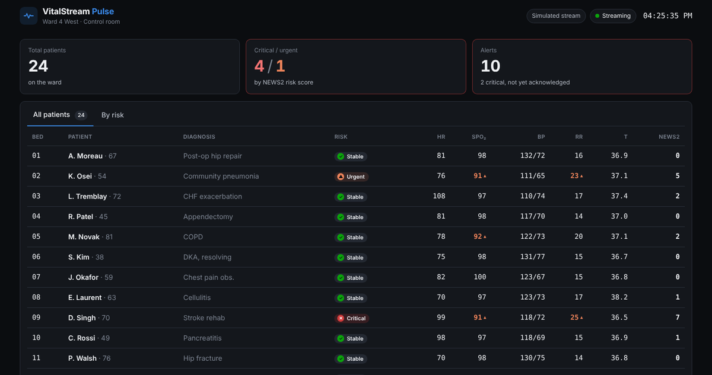
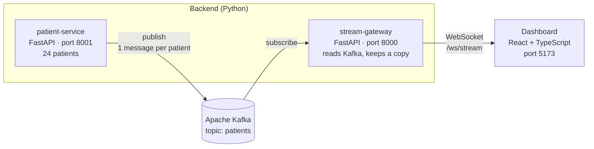

# VitalStream Pulse

**Event-driven patient monitoring demo: Kafka + FastAPI (async) backend, WebSocket gateway, React + TypeScript dashboard.**


A live "control room" for a hospital ward of 24 beds. Patient data travels through
**Apache Kafka** between small **FastAPI** services and is pushed to a
**React + TypeScript** dashboard over a **WebSocket**, so the screen updates the
moment new data arrives, with no page refresh.

I'm building it step by step to learn Kafka, async FastAPI and microservices.



*The dashboard: summary cards and a table of every patient, sortable by bed or by risk.
This screenshot uses the dashboard's built-in simulated data. In live mode, the patient
list comes from the backend through Kafka, and live vital signs are the next step.*

---

## How it works



1. **patient-service** holds the 24 patients. `send_patients.py` publishes them to the
   Kafka topic `patients`, one message per patient, keyed by patient ID.
2. **Kafka** stores the messages on disk. Nothing is lost if a service is down.
3. **stream-gateway** subscribes to `patients` in the background and keeps the newest
   copy of each patient. Duplicates with the same ID simply replace the old copy.
4. The **dashboard** opens a WebSocket to `ws://localhost:8000/ws/stream`. The gateway
   sends the full patient list as soon as it connects, and again whenever Kafka delivers
   a change.

Messages to the dashboard look like this:

```json
{ "topic": "patients.all-list", "ts": 1760700000000, "payload": [ { "id": "P-1001", "bed": "01", "name": "A. Moreau", "age": 67, "diagnosis": "Post-op hip repair" } ] }
```

---

## Tech stack

| Part | Technology |
|---|---|
| Message broker | Apache Kafka 3.9 (KRaft, single node) in Docker, Kafka UI for browsing topics |
| Backend services | Python 3.12, FastAPI, uvicorn (`--reload`), aiokafka (async Kafka client) |
| Live connection | WebSocket (FastAPI to the browser) |
| Frontend | React 18, TypeScript (strict), Vite |

---

## Project structure

```
vitalStream/
├── backend/
│   ├── docker-compose.yml        Kafka + Kafka UI
│   ├── dev.ps1                   one command: start Kafka, then both services with auto-reload
│   ├── requirements.txt          Python libraries
│   ├── patient-service/
│   │   ├── main.py               FastAPI app: GET /patients
│   │   ├── patients_data.py      the 24 patients
│   │   └── send_patients.py      publishes every patient to Kafka
│   └── stream-gateway/
│       └── main.py               reads Kafka, pushes to browsers over WebSocket
└── dashboard/
    ├── .env.example              VITE_STREAM_URL (copy to .env)
    └── src/
        ├── App.tsx
        ├── components/           TopBar, KpiStrip (cards), PatientTable (tabs + table)
        ├── store/vitalStore.ts   keeps the live data, redraws a few times per second
        ├── stream/               WebSocketStream (live) / MockStream (simulated)
        └── types/contracts.ts    the message shapes shared with the backend
```

---

## Getting started (Windows)

### Prerequisites

- [Docker Desktop](https://www.docker.com/products/docker-desktop/) (runs Kafka)
- [Python 3.12](https://www.python.org/downloads/) (tick "Add python.exe to PATH")
- [Node.js 20 LTS](https://nodejs.org/)

### 1. Start the backend

Open Docker Desktop and wait for "Engine running". Then:

```powershell
cd backend
powershell -ExecutionPolicy Bypass -File dev.ps1
```

`dev.ps1`:

1. creates the Python environment (`.venv`) the first time;
2. starts Kafka and waits until it's ready;
3. runs **patient-service** (port 8001) and **stream-gateway** (port 8000), both with
   auto-reload.

Press **Ctrl+C** to stop the services.

### 2. Put the patients into Kafka

In a second terminal:

```powershell
cd backend
.venv\Scripts\python patient-service\send_patients.py
```

### 3. Start the dashboard

```powershell
cd dashboard
copy .env.example .env      # contains VITE_STREAM_URL=ws://localhost:8000/ws/stream
npm install                 # first time only
npm run dev
```

Open **http://localhost:5173**. The top bar shows **Live · FastAPI gateway** and
**Streaming**, and the table lists all 24 patients.

To try the dashboard **without the backend**, delete `dashboard/.env`. It then runs on
built-in simulated data, as in the screenshot.

### Addresses

| What | Where |
|---|---|
| Dashboard | http://localhost:5173 |
| Patient service | http://localhost:8001/patients (API docs: `/docs`) |
| Stream gateway | `ws://localhost:8000/ws/stream` |
| Kafka UI | http://localhost:8080 |
| Kafka (for Python code) | `localhost:9094` |

---

## Roadmap

- [x] Kafka in Docker with Kafka UI
- [x] Patient service with 24 patients
- [x] Publish patients to Kafka
- [x] Stream gateway: Kafka to WebSocket to dashboard
- [x] Dashboard: summary cards, patient table, "All patients" / "By risk" tabs
- [ ] Patient service publishes on startup (instead of a separate script)
- [ ] Live vital signs: simulated monitors to Kafka to dashboard
- [ ] Danger score (NEWS2) service
- [ ] Alerts service
- [ ] Every service in Docker
- [ ] Database for patients

---

*Demo data only. The NEWS2 score is simplified and not for clinical use.*
