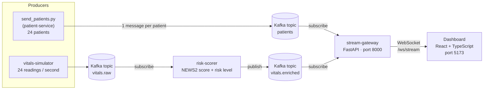

# VitalStream Pulse

**Event-driven patient monitoring demo: Kafka + async FastAPI microservices, a WebSocket gateway, and a React + TypeScript dashboard that shows live vital signs and NEWS2 risk for 24 beds.**


A live "control room" for a hospital ward of 24 beds. Simulated bedside monitors send
vital signs into **Apache Kafka** every second, a scoring service works out each
patient's **NEWS2** risk, and a **FastAPI** gateway pushes everything to a
**React + TypeScript** dashboard over a **WebSocket**, so the screen updates the moment
new data arrives, with no page refresh.

I'm building it step by step to learn Kafka, async FastAPI and microservices.


*The dashboard: summary cards, then every patient with their latest vitals, NEWS2 score
and risk level, 10 per page. Switch to "By risk" to see the sickest patients first.*

---

## How it works



1. **patient-service** holds the 24 patients. `send_patients.py` publishes them to the
   topic `patients`, one message per patient, keyed by patient ID.
2. **vitals-simulator** pretends to be 24 bedside monitors. Every second it sends one
   reading per patient (heart rate, SpO₂, blood pressure, breathing rate, temperature)
   to `vitals.raw`.
3. **risk-scorer** reads `vitals.raw`, adds a simplified **NEWS2** score and a risk level
   (`stable`, `watch`, `urgent`, `critical`), and writes the result to `vitals.enriched`.
4. **stream-gateway** reads `patients` and `vitals.enriched` in the background and
   forwards both to every open browser over the WebSocket.
5. The **dashboard** connects to `ws://localhost:8000/ws/stream`, shows the patient list
   straight away, and updates each row as new readings arrive.

Kafka keeps every message on disk, so a service can stop and start again without
breaking the others.

### Consumer groups

| Group | Service | Reads | Note |
|---|---|---|---|
| `risk-scorer` | risk-scorer | `vitals.raw` | Saves its place, so it carries on where it stopped |
| `stream-gateway-patients` | stream-gateway | `patients` | Reads from the beginning each start, to get the full list |
| `stream-gateway-vitals` | stream-gateway | `vitals.enriched` | Only new readings; doesn't save its place (lag shows N/A in Kafka UI) |

### Messages to the dashboard

```json
{ "topic": "patients.all-list", "ts": 1760700000000, "payload": [ { "id": "P-1001", "bed": "01", "name": "A. Moreau", "age": 67, "diagnosis": "Post-op hip repair" } ] }
```

```json
{ "topic": "vitals.enriched", "ts": 1760700000000, "payload": { "patientId": "P-1005", "ts": 1760700000000, "hr": 116, "spo2": 89, "sbp": 98, "dbp": 63, "rr": 30, "temp": 38.1, "news2": 11, "risk": "critical" } }
```

---

## Tech stack

| Part | Technology |
|---|---|
| Message broker | Apache Kafka 3.9 (KRaft, single node) in Docker, Kafka UI for browsing topics |
| Backend services | Python 3.12, FastAPI, uvicorn (`--reload`), aiokafka (async Kafka client), asyncio |
| Live connection | WebSocket (FastAPI to the browser) |
| Frontend | React 18, TypeScript (strict), Vite |

---

## Project structure

```
vitalStream/
├── backend/
│   ├── docker-compose.yml        Kafka + Kafka UI
│   ├── dev.ps1                   one command: Kafka + all four services in one window
│   ├── requirements.txt          Python libraries
│   ├── patient-service/
│   │   ├── main.py               FastAPI app: GET /patients
│   │   ├── patients_data.py      the 24 patients
│   │   └── send_patients.py      publishes every patient to Kafka
│   ├── vitals-simulator/
│   │   └── main.py               fake monitors -> vitals.raw
│   ├── risk-scorer/
│   │   └── main.py               vitals.raw -> NEWS2 score -> vitals.enriched
│   └── stream-gateway/
│       └── main.py               patients + vitals.enriched -> browsers over WebSocket
└── dashboard/
    ├── .env.example              VITE_STREAM_URL (copy to .env)
    └── src/
        ├── App.tsx
        ├── components/           TopBar, KpiStrip (cards), PatientTable (tabs, table, pagination)
        ├── store/vitalStore.ts   keeps the live data, redraws a few times per second
        ├── stream/               WebSocketStream: connects to the gateway, reconnects if it drops
        └── types/contracts.ts    the message shapes shared with the backend
```

---

## Getting started (Windows)

### Prerequisites

- [Docker Desktop](https://www.docker.com/products/docker-desktop/) (runs Kafka)
- [Python 3.12](https://www.python.org/downloads/) (tick "Add python.exe to PATH")
- [Node.js 20 LTS](https://nodejs.org/)

### 1. Start the backend

Open Docker Desktop and wait for "Engine running". Then:

```powershell
cd backend
powershell -ExecutionPolicy Bypass -File dev.ps1
```

`dev.ps1`:

1. creates the Python environment (`.venv`) the first time;
2. starts Kafka and waits until it's healthy;
3. runs everything in the **same window**:
   - **patient-service** (port 8001, auto-reload)
   - **stream-gateway** (port 8000, auto-reload)
   - **risk-scorer**
   - **vitals-simulator**

Press **Ctrl+C** to stop all of them.

### 2. Put the patients into Kafka

In a second terminal (needed once; Kafka keeps them after that):

```powershell
cd backend
.venv\Scripts\python patient-service\send_patients.py
```

### 3. Start the dashboard

```powershell
cd dashboard
copy .env.example .env      # contains VITE_STREAM_URL=ws://localhost:8000/ws/stream
npm install                 # first time only
npm run dev
```

Open **http://localhost:5173**. The top bar shows **Live · FastAPI gateway** and
**Streaming**, the table lists all 24 patients, and the vitals change every second.

If the top bar says **Reconnecting**, the gateway isn't running yet. Start the backend
and the dashboard connects again by itself.

### Addresses

| What | Where |
|---|---|
| Dashboard | http://localhost:5173 |
| Patient service | http://localhost:8001/patients (API docs: `/docs`) |
| Stream gateway | `ws://localhost:8000/ws/stream` |
| Kafka UI | http://localhost:8080 (topics, messages, consumer groups) |
| Kafka (for Python code) | `localhost:9094` |

---

## Roadmap

- [x] Kafka in Docker with Kafka UI
- [x] Patient service with 24 patients
- [x] Publish patients to Kafka
- [x] Stream gateway: Kafka to WebSocket to dashboard
- [x] Dashboard: summary cards, patient table, "All patients" / "By risk" tabs, pagination
- [x] Live vital signs: vitals-simulator to Kafka to dashboard
- [x] Risk scorer (NEWS2) service
- [x] `dev.ps1` runs Kafka and every service in one window
- [ ] Patient service publishes on startup (instead of a separate script)
- [ ] Alerts service
- [ ] Every service in Docker
- [ ] Database for patients

---

*Demo data only. The NEWS2 score is simplified and not for clinical use.*
